

  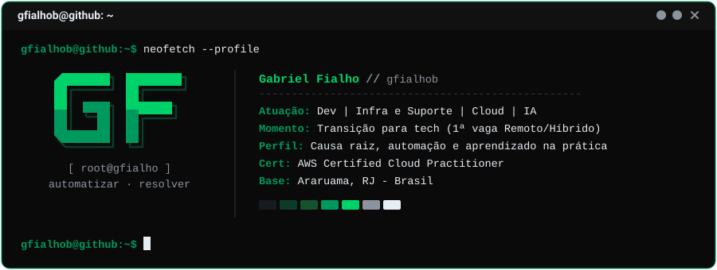
   
  
  

  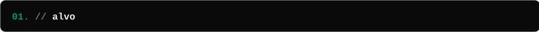
  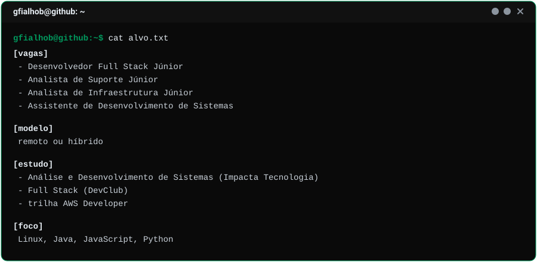

  

  
Só o que eu uso e estudo:

  

 

  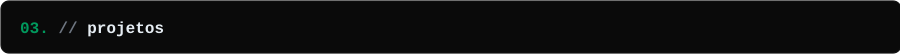
  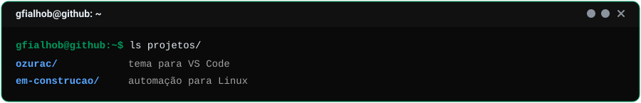

  

    <strong><a href="https://marketplace.visualstudio.com/items?itemName=gb-bittencourt.ozurac">Ozurac</a></strong>
    (<a href="https://github.com/gfialhob/Ozurac">código</a>):
    Tema escuro para VS Code, publicado no Marketplace. Acentos em verde escuro, foco em contraste, legibilidade e conforto visual para longas sessões de código. Inclui tema de ícones de arquivo próprio e cores do terminal alinhadas à paleta.
  

  

    <strong>Em construção:</strong> script em Python ou Bash para automatizar rotinas de manutenção em Linux.
  

 

  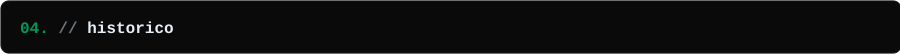
  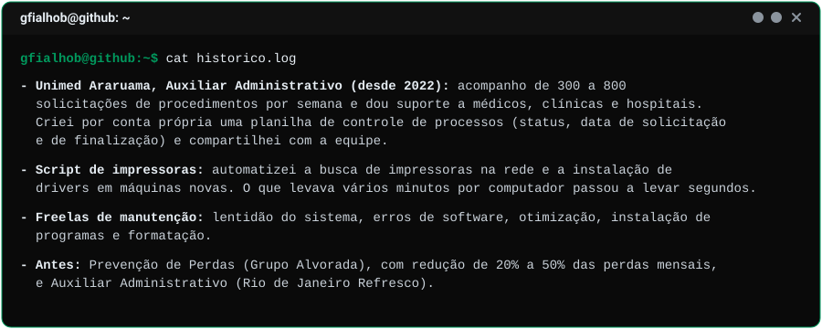

 

  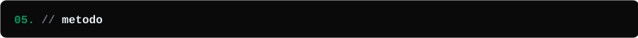
  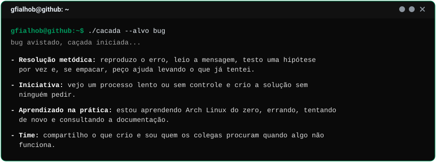

 

  
  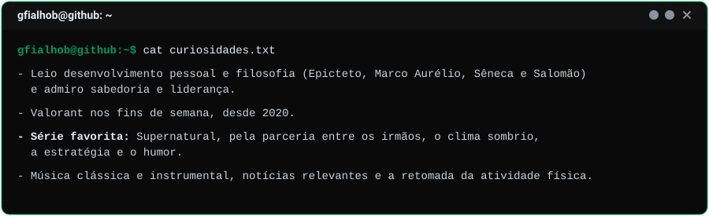

 

  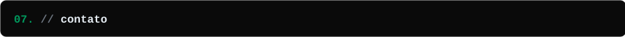

  
LinkedIn: <a href="https://linkedin.com/in/gfialhob">linkedin.com/in/gfialhob</a>

  
Tem um bug, uma vaga ou uma ideia? Me chama por lá.

  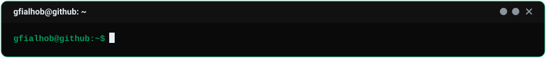

